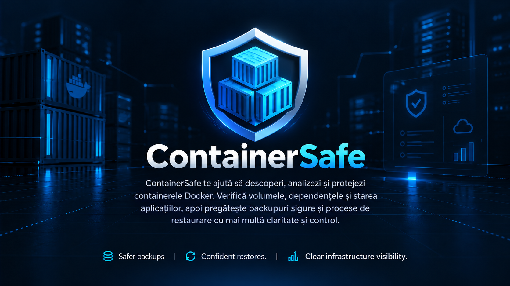

<div align="center">

# 🛡️ ContainerSafe

### Discover. Audit. Protect. Recover.

**Version 0.17** · Next releases increment by **0.01** (0.18, 0.19, …).

**Know what your Docker applications depend on — before you need to restore them.**

ContainerSafe is an early-stage **Rust-powered Docker backup readiness and recovery project**, with a lightweight **Slint desktop interface** and a CLI. It discovers containers and Compose projects, identifies persistent data, flags backup risks, and helps build explicit, reviewable backup plans.

[](https://www.rust-lang.org/)
[](https://slint.dev/)
[](https://www.docker.com/)


[Overview](#why-containersafe) · [Features](#current-capabilities) · [Getting started](#getting-started) · [Roadmap](#roadmap) · [Contribute](#contributing)



*English and Romanian interfaces are available from File → Settings. Splash artwork remains a fixed image.*

</div>

> [!IMPORTANT]
> **Developer preview, not a production backup solution.** Docker discovery, backup planning, selection validation, and limited preflight checks have been demonstrated. The Restic backup/restore integration is currently a **local disposable-file laboratory**. Automated Docker backups, database-consistent production snapshots, and full-stack recovery are **not implemented or validated**. Keep using your established backup strategy.

## Why ContainerSafe?

A running Docker container is not a backup. Recovering a self-hosted application may require more than its image: bind mounts, named volumes, database dumps, Compose YAML, environment files, and services outside Docker.

ContainerSafe aims to make these dependencies **visible, reviewable, and recoverable** — without silently assuming that a mounted directory is safe to copy or that a successful archive guarantees a working restore.

### Designed for

- 🏠 **Self-hosters & homelabs** running Docker Compose stacks.
- 🗄️ **NAS owners** who want an inventory of persistent application data.
- 🧑‍💻 **Developers** maintaining several Docker services.
- 🛠️ **Small teams** seeking clearer backup and restore procedures.

## Current capabilities

| Capability | Status | Notes |
|---|---|---|
| Docker container discovery | ✅ Tested | Lists running and stopped containers over SSH |
| Compose project grouping | ✅ Tested | Uses Docker Compose labels; standalone containers are separate |
| Bind mount & named volume inventory | ✅ Tested | Classifies candidate sources, without assuming completeness |
| Database risk detection | ✅ Basic | Recognizes common PostgreSQL / MySQL / MariaDB / Redis image patterns |
| Backup readiness audit | ✅ Basic | Flags missing configuration and consistency requirements |
| Backup plan JSON | ✅ Tested | Generates a schema-versioned, read-only proposal |
| Explicit include/exclude/dump selection | ✅ Tested | Requires decisions; prevents naive raw PostgreSQL volume selection |
| Selection validation | ✅ Tested | A valid selection is **not** permission to execute a backup |
| Remote preflight | 🧪 Partial | Checks current Docker mounts and in-container readability |
| Restic lab: init, backup, integrity check, restore | ✅ Local test | Disposable Windows test data only; two-snapshot test passed |
| Native Slint UI | 🧪 Preview | Manages SSH servers and uses the shared Rust core for discovery/validation |
| Startup splash / stage status | 🧪 Preview | Slint screen with real startup steps, not fake loading animation |
| Production Docker backups | ⏳ Planned | Agent, destination handling, scheduling, safe execution |
| Database-consistent full-stack restore | ⏳ Planned | Restore drills and application-level checks |

**Principle:** *A successful snapshot is not the same thing as a successful restore.*

## Architecture

```text
ContainerSafe (Rust)
│
├── CLI                       # Discover, audit, plan, validate, preflight
│   └── SSH → Docker Engine   # Current discovery connection
│
├── native/                   # Slint desktop (no browser/WebView)
│   ├── ui/                   # Native view definitions + splash
│   └── src/                  # Rust UI orchestration
│
└── Restic lab                # Local experimental backup/restore tests

Planned refactor:
containersafe-core → containersafe-cli / containersafe-native / containersafe-agent
```

The CLI and desktop share the root `containersafe` Rust library: server identities, SSH, profile storage, Docker plans and validation. A dedicated Linux agent and production backup executor are future work.

## Getting started

Windows MSI and Linux DEB/tar.gz builds are automated through GitHub Actions. See [creating a GitHub release](docs/RELEASING.md). Tags use the display version, starting with `v0.09`; macOS packages are deferred.

Installer builds run only when a version tag (`v*`) is pushed. Ordinary commits and branch pushes do not start GitHub Actions; publishing the generated release draft does not trigger another build.

### Prerequisites

- **Rust and Cargo** (a toolchain compatible with Slint 1.18).
- **Windows:** Visual Studio C++ Build Tools / MSVC and Windows SDK. SSH uses `russh` with `ring`, without OpenSSL or Perl. Ed25519, ECDSA and RSA keys in compatible OpenSSH/PEM/PKCS#8 formats are supported, including encrypted keys. PuTTY keys use the documented encrypted export workflow. See [SSH compatibility](docs/SERVER_MANAGEMENT.md#credentials-and-keys).
- **For Docker discovery:** an SSH-accessible Docker host and an account permitted to query Docker. Configure a server in the native app first. Connections pin the host key before authentication; Docker access is discovered using a restricted command list.
- **For the local Restic engine/lab:** a Restic executable (validated with 0.19.1), configured explicitly or available on `PATH`.

### 1. Clone and build

```powershell
git clone https://github.com/matrixn/ContainerSafe.git
cd ContainerSafe
cargo build
cargo test
```

### 2. Try the CLI

```powershell
cargo run -- discover
cargo run -- audit
cargo run -- plan
cargo run -- preflight
```

Commands use the configured default server, or accept `--server UUID`. There is no implicit production host or SSH alias. `plan` persists its output under the selected server UUID; `draft` prints a proposed selection and `validate`/`preflight` read that server’s saved selection. CLI authentication uses remembered OS credentials or an unencrypted private key; use the desktop for session-only passwords/passphrases and host-key approval.

**PowerShell 5.1 users:** plain `>` can save redirected native program output in UTF-16. Use the desktop app's **Refresh Docker** / **Save selections** buttons or write the files explicitly in UTF-8. Do not commit the generated JSON files.

### 3. Run the native Slint desktop

```powershell
cargo run --manifest-path .\native\Cargo.toml
```

In VS Code, use **Terminal → Run Task → Run ContainerSafe desktop**. **Ctrl+Shift+B** builds the desktop. Plain `cargo run` in the repository root starts the CLI; without a configured default server or `--server UUID`, it exits with a server-selection message. Use the desktop command above to configure your first server.

After the splash, first launch opens **New Docker Server**. Configure and test SSH, review the host fingerprint, then save. Later launches connect to the default server asynchronously. **File → Servers...** manages profiles and switches servers; the selected server and version are visible in the application bar. Offline servers leave the app open.

The light workspace separates **Containers** (searchable Compose/project/container and standalone tree, with storage/database review) from **Backup plans** (only stacks/containers with a selectable backup method). Choose decisions explicitly from dropdowns; **No backup** means no method selected yet, while **Exclude** records an explicit skip. Info icons explain each available option and unsupported database backups. Protected raw database paths cannot be included. See [interface and Romanian test instructions](docs/UI_REDESIGN.md).

Profiles live in `%APPDATA%\ContainerSafe\servers.json` on Windows, with per-server backup data under `servers/<uuid>/`. Passwords/passphrases use the OS credential store, or remain session-only when Remember is unchecked. Existing repository JSON files are never imported automatically. See [server setup, PPK integration, migration and validation](docs/SERVER_MANAGEMENT.md).

### 4. Run the isolated backup/restore lab (optional)

```powershell
restic version
cargo run --locked -- lab-backup
# Or choose the executable explicitly:
cargo run --locked -- lab-backup --restic C:\Users\radut\bin\restic.exe
```

**Lab only:** this command uses the shared, typed Restic engine on disposable local files. It creates two snapshots, checks all repository data and verifies three isolated restores by comparing bytes. It uses a random session-only password, which is never saved or printed. The retained fixture directories are inspectable, but their disposable encrypted repository cannot be reopened after the lab exits. No server connection or production Docker data is used. `CONTAINERSAFE_RESTIC` can also select the executable. See [the v0.12 engine scope and Romanian test instructions](docs/RESTIC_ENGINE.md).

## Example workflow

The Linux `containersafe-agent` binary now exposes versioned JSON requests over stdin/stdout for configured local jobs. It reuses the Restic engine and requires explicit operation permissions and private password files. See [agent setup and disposable Linux testing](docs/LINUX_AGENT.md). Desktop-to-agent orchestration and consistent database backups are subsequent milestones.

```text
1. Discover Docker services
2. Audit mounts and possible databases
3. Review the generated backup plan
4. Select sources and database strategies
5. Validate decisions
6. [Future] Run full preflight and backup
7. [Future] Verify an isolated restore
```

> [!WARNING]
> Do not use the current manifest as proof that all application data has been found. External databases, `.env` files, Compose overlays, large media directories, and application-level consistency must be checked separately.

## Roadmap

- [x] Read-only Docker discovery and Compose grouping
- [x] Backup readiness analysis and JSON plans
- [x] Selection validation with risky-source checks
- [x] Local Restic backup, integrity check, incremental snapshot, and restore test
- [x] Reusable typed local Restic engine with secret references and guarded isolated restores
- [x] Linux stdio agent with configured jobs, explicit operation permissions and file-permission checks
- [x] Native Slint desktop prototype
- [x] Shared Rust core for CLI and desktop, explicit server UUIDs and isolated local data
- [x] Server manager, pinned SSH identities, OS credentials and default-server startup
- [ ] Robust cross-platform CLI, configuration and error handling
- [ ] Desktop-to-agent transport and Docker/database orchestration with least-privilege considerations
- [ ] Complete preflight: paths, permissions, size, Compose files, external dependencies
- [ ] PostgreSQL-consistent backup adapter and disposable integration tests
- [ ] Restic destination management, scheduling and retention
- [ ] Isolated application restore verification
- [ ] Linux/macOS desktop testing and packaged releases

Suggestions and use cases are welcome in [GitHub Issues](https://github.com/matrixn/ContainerSafe/issues).

## Security by design

- Discovery and audit commands are **read-only**.
- Docker socket access is **high privilege**; never expose it publicly.
- Socket mounts and other host resources are excluded from candidate data backups.
- Plans and selections are reviewable, and validation **does not authorize execution**.
- Never commit `.env`, SSH keys, repository passwords, generated manifests, or customer data.
- Test restores using disposable fixtures, not live production volumes.

For sensitive reports, see [SECURITY.md](SECURITY.md). Avoid publishing credentials or host inventory in public issues.

## Contributing

This is an early preview; feedback, reproducible bug reports, Windows/Linux compatibility notes and design discussions are especially helpful.

- 🐛 [Report a bug](https://github.com/matrixn/ContainerSafe/issues/new?template=bug_report.yml)
- 💡 [Suggest a feature](https://github.com/matrixn/ContainerSafe/issues/new?template=feature_request.yml)
- ⭐ [Star ContainerSafe](https://github.com/matrixn/ContainerSafe) to follow its development

See [CONTRIBUTING.md](CONTRIBUTING.md) for development conventions.

## License and distribution

**License not selected yet.** Until a `LICENSE` file is published, do not assume that the repository grants permission to redistribute, modify, or commercially use its contents. The Slint framework has its own licensing terms; these must also be reviewed before distributing the desktop application.

---

<div align="center">

**ContainerSafe — built for people who self-host, and care about recovering what they run.**

[⭐ Star](https://github.com/matrixn/ContainerSafe) · [🐛 Issues](https://github.com/matrixn/ContainerSafe/issues)

</div>

## Desktop preferences and language (0.17)

Open **File → Settings** (Romanian: **Fișier → Setări**), also available in the sidebar. Each preference has a description and saves immediately, with a confirmation below the changed setting. English is the default; Romanian applies immediately to navigation, dialogs, help and backup choices. Remote SSH/Docker output and technical diagnostic details retain their original text.

- Language: English / Română.
- Startup page: Containers / Backup plans. Applied on the next launch.
- Initial source filter: All sources / Storage / Databases. Applied on the next launch; the workspace filter remains freely adjustable.
- New server defaults: SSH port (22, 2022, 2222), timeout (10, 30, 60, 120 seconds), Docker access (Automatic, Direct, passwordless sudo). Existing profiles are unchanged; all supported values can still be entered in the server form.
- Connect on startup: On / Off. On preserves the existing default-server startup flow; Off starts disconnected for manual connection through Servers. Host-key verification is always mandatory.

Preferences live in `settings.json` beside `servers.json`, contain no secrets, and are separate from per-server backup selections. A failed save keeps the previous value active and shows an error. Invalid or unsupported configuration is preserved and editing is blocked rather than silently overwriting it.

To add or maintain Romanian translations, edit `native/translations/ro.json`, then run `python scripts/update-translations.py` (or `--check` to verify the bundled gettext catalog). Translations are built into the application; no gettext runtime or download is required.
