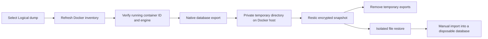

# Database backups — ContainerSafe 0.35

The desktop can now execute **Logical dump** selections before an encrypted Restic
backup. This is a manual database-export workflow, not automatic application recovery.
Database-only plans work; adding an ordinary file source is not required. The same
export preparation runs before direct SSH, optional Linux-agent and reverse-tunnel
PC backups. SFTP Pull and SSH Streaming still transfer an encrypted snapshot export,
not plaintext database files.



## Implemented adapters and boundaries

| Engine | Export | Consistency and limits |
|---|---|---|
| PostgreSQL | `pg_dumpall --no-password` on local TCP 5432 | All databases and global roles. Each database is internally consistent, but databases are dumped sequentially: no single cluster-wide snapshot, PITR or coordinated application snapshot. Requires cluster-wide read privileges, normally a database superuser. |
| MariaDB | `mariadb-dump --all-databases --lock-all-tables --quick --routines --events --triggers --hex-blob` on local TCP 3306 | Global read lock for the whole dump, including nontransactional tables. **Writes wait until export completes.** Requires root credentials and lock privileges. No silent fallback to an inconsistent unlocked dump. |
| MySQL | Same options using `mysqldump` | Same global read-lock behavior; restore into a compatible engine/version. Export is not binlog/PITR configuration. |
| Redis / Valkey | `redis-cli` or `valkey-cli --rdb` on local 6379 | Fresh RDB through the replication protocol; checks command exit status. Requires INFO and replication permissions. Cluster mode is rejected; ACL/configuration and AOF history are not included. Existing persistence settings are not changed. |
| MongoDB | `mongodump --archive --gzip --oplog` on local 27017 | Full replica-set-member export with oplog. `mongosh` checks replica-set topology before exporting. Standalone, mongos/sharded, alternate remote URIs, and scoped collection exports are unsupported. Use `mongorestore --oplogReplay` for recovery. Avoid concurrent schema/user changes; tool failures abort the backup. |
| SQLite | `sqlite3 -readonly` online `.backup`, followed by `PRAGMA quick_check` | One explicitly labelled regular database file. Requires `sqlite3` and writable `/tmp` inside the application container. The live file/WAL/SHM are not copied generically. No automatic embedded-database discovery. |

No running container is started, stopped, paused, or reconfigured. Native export
tools must already exist **inside** each selected running container, including `sh`.
Custom ports, custom database clients, TLS-only in-container endpoints, multi-node
coordination and external databases are not configurable in this first adapter version.

## Credentials stay inside the container

There are no database password fields in ContainerSafe. These are existing container
environment/configuration conventions, not secrets to paste into application settings:

| Engine | Supported credentials |
|---|---|
| PostgreSQL | Username `PGUSER`, then `POSTGRES_USER`, default `postgres`. Password `POSTGRES_PASSWORD_FILE`, otherwise `PGPASSWORD`, then `POSTGRES_PASSWORD`. |
| MariaDB/MySQL | User `root`. `MARIADB_ROOT_PASSWORD_FILE` / `MYSQL_ROOT_PASSWORD_FILE`, otherwise `MARIADB_ROOT_PASSWORD`, `MYSQL_ROOT_PASSWORD`, then `MYSQL_PWD`. |
| Redis/Valkey | `REDIS_PASSWORD_FILE`, otherwise `REDISCLI_AUTH`, then `REDIS_PASSWORD`. Optional ACL user `CONTAINERSAFE_REDIS_USER`. The account needs INFO and replication-command permissions. |
| MongoDB | For authentication, set `CONTAINERSAFE_MONGO_CONFIG` to an existing regular, non-symlink **mode 600** file inside the container. It must contain one YAML `password:` entry (quoted as required by YAML), optional blank/comment lines, and no URI/other options. Username comes from `MONGO_INITDB_ROOT_USERNAME`, authentication database `admin`. No-auth replica sets work without this config. Initial root-password environment variables alone are not automatically used. |
| SQLite | Existing container user must be able to read the labelled database and create private temporary files. |

`_FILE` paths must be readable regular non-symlink files. Missing clients, authentication
failures, insufficient privileges and unsupported topology fail closed. Passwords are
not copied to the PC, exported setup, command-line arguments or logs by these adapters.
PostgreSQL/MySQL SQL dumps may themselves contain user/password hashes: treat all
restored dump files as secrets. Database exports are temporarily plaintext before Restic
encrypts them; this is not an end-to-end encrypted database-to-Restic pipe.

## Configure SQLite explicitly

Add labels to the relevant service in your own Compose configuration:

```yaml
labels:
  containersafe.database: "sqlite"
  containersafe.sqlite.path: "/data/application.sqlite"
```

Use the actual **in-container** file path. Apply your Compose change yourself, then
refresh ContainerSafe. One SQLite file is supported per labelled container. All of that
container's candidate mounts receive the protected database policy; select its database
entry instead of including its live data directory. Review other required application
files separately. Image names alone do not detect embedded SQLite databases.

## First backup, step by step

1. Connect and refresh the server. Open **Containers** and choose the Compose group
   or standalone container. Review the **DB** entry's info tooltip.
2. Choose **Logical dump** for the intended database. Leave live database paths out
   of **Include**; use **Exclude** to record that review. Choose ordinary file sources
   separately. **Save changes** preserves selections; **Validate** checks review completeness.
3. Open the corresponding **Backup plans** entry. Choose **Destination for this plan**
   and the existing Restic execution/credentials settings.
4. Set **Isolated restore folder** to an existing SSH-owned directory outside ordinary
   sources and the repository, preferably mode 700. It must not be writable by another
   user/group. DSM system-managed ancestor aliases are resolved, not recreated.
5. **Save plan**. For agent mode, **Export setup** again and install the changed agent
   configuration: it now explicitly authorizes the job's temporary database-export source.
   The desktop prepares the dumps; standalone agent invocation is not a database scheduler.
6. If this is a new repository, **Initialize repository** once. A database export is
   not performed during initialization/listing/checking/restoring.
7. Read and enable the existing acknowledgment, then **Back up now**. MySQL/MariaDB
   holds the documented global read lock. The application remains a manual preview;
   database dump preparation has a one-hour SSH timeout and no exposed cancellation.
8. **List snapshots**, select the exact snapshot, **Check all data**, then **Test restore**
   into a new isolated folder. PC destinations also support **Verify on PC** and
   **Test restore on PC** with the independently supplied local password file.
9. Follow the import instructions below **against a disposable instance** and compare
   representative records. A verified Restic file restore is not a database import test.

## Export layout, cleanup and interruption

The private host directory is:

```text
<isolated-restore-folder>/containersafe-db-<job-uuid>/
  manifest.json
  <full-docker-container-id>.dump
```

`manifest.json` maps each file to its engine and container name. File content is SQL
for PostgreSQL/MySQL/MariaDB, RDB for Redis/Valkey, gzipped MongoDB archive with oplog,
or an SQLite database. The extension is intentionally uniform; use the manifest.
Restic records the source's canonical absolute path; locate that tree inside the
isolated restore target, not by assuming the dump is at its top level.

The SSH account exclusively creates the stage (700); dump files use umask 077.
Existing stages are **never overwritten or reused**. All selected exports must exit
successfully and produce nonempty output before Restic starts. Export failure removes
partial host files where possible. After Restic success **or failure**, the desktop
requests removal of only known dump/manifest files and the empty directory, without
recursive deletion. Cleanup failure is reported separately, even after snapshot success.

A crash, forced disconnect, power failure, killed shell or failed cleanup can leave
private plaintext exports or in-container `/tmp/containersafe-db.*` files. Confirm no
operation is running, inspect the exact directory and remove only those task-owned
files manually. Never reuse a stale dump as a new backup and never automatically
unlock a Restic repository. Cancellation remains available for file-only transport
operations; it is hidden for database plans because dump cancellation is not guaranteed.

## Recover database contents

First restore and verify files to an isolated directory using Restic. Keep the repository
password independently recoverable. Import to a disposable compatible engine, using
its own securely configured credentials:

| Engine | Manual recovery procedure |
|---|---|
| PostgreSQL | Feed the SQL dump to `psql` on a fresh compatible cluster. Review roles/tablespaces/ownership; an already-present bootstrap role can produce a role-exists error. Verify all intended databases and records; do not hide other errors. |
| MariaDB/MySQL | Feed SQL to the matching `mariadb`/`mysql` client on an isolated compatible server. Review privilege/system-table/version compatibility before any production restore. |
| Redis/Valkey | Validate with `redis-check-rdb`/`valkey-check-rdb`; start an isolated server using the restored RDB and AOF disabled for that test. Confirm keys/TTL and authentication separately. Never replace a live persistence file. |
| MongoDB | Feed the archive to `mongorestore --archive --gzip --oplogReplay` on an isolated compatible replica set. Review overwrite/drop options explicitly; application code does not run this command for you. |
| SQLite | Open a copy with `sqlite3 -readonly`, run `PRAGMA integrity_check;`, and verify expected records. Test application integration separately before replacing any stopped application's file. |

## Verification

The opt-in fixture `scripts/database_lab.py` creates UUID-named disposable Docker
containers, exercises the exact server export script and real Restic init/backup/check/
isolated restore, then checks data with native clients. It removes only its own containers
and anonymous volumes; it never prunes images or connects to a production server.

```sh
python3 scripts/database_lab.py --restic /absolute/path/to/restic
```

This requires Linux, Python 3, a working Docker daemon, image-download access, and
space for official PostgreSQL, MariaDB, MySQL, Redis, MongoDB and Alpine images.
The fixture's Alpine container temporarily uses bridge networking only to install
`sqlite`; it is disconnected before database export. No host ports are published.
See the current changelog for checks actually run and their limits. Live Synology DSM
and provider-specific production configurations require separate validation.

## References

- [PostgreSQL pg_dumpall](https://www.postgresql.org/docs/17/app-pg-dumpall.html)
- [MariaDB mariadb-dump](https://mariadb.com/docs/server/clients-and-utilities/backup-restore-and-import-clients/mariadb-dump)
- [MySQL mysqldump](https://dev.mysql.com/doc/refman/8.0/en/mysqldump.html)
- [Redis CLI RDB backups](https://redis.io/docs/latest/develop/tools/cli/)
- [MongoDB mongodump](https://www.mongodb.com/docs/database-tools/mongodump/)
- [SQLite online backup](https://sqlite.org/backup.html)
